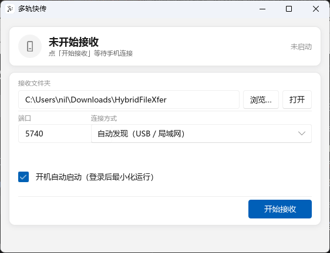

# 多轨快传

当前版本 **3.7.0** · 安卓界面基于 **Miuix 0.9** · 许可 **GPL-3.0**

📥 [下载最新版本](https://github.com/yizhiruonan/HybridFileXfer/releases) ｜ 安卓 **8.0（API 26）及以上** ｜ 电脑端 **Windows 10 及以上**（x64 / ARM64，**不需要 Java**）

多轨快传（原双轨快传）：把手机的 USB、WiFi、热点等多张网卡同时用起来，把文件传到电脑。手机与电脑点对点直连，不经过任何服务器。

原作者实测：USB2.0 + WiFi6（千兆网口）150 MB/s；USB2.0 + WiFi6 5G:160MHz + 2.4G:40MHz 200+ MB/s。
本项目实测：USB2.0（adb 约 38 MB/s）+ WiFi6 5GHz（1201 Mbps 协商）聚合稳定约 **76 MB/s**，实际取决于网卡、数据线与电脑磁盘。

## 项目结构

| 目录 | 说明 |
| --- | --- |
| `HybridFileXfer-Android/` | 安卓客户端（Java + Jetpack Compose / Miuix UI） |
| `HybridFileXfer-Receiver/` | 电脑接收器（Rust + Slint，原生 Windows 风格界面；GUI 与 CLI 双入口，不需要 Java） |
| `HybridFileXfer-PC/` | 经典 Java 电脑客户端源码（旧版，可选；不含 jar 与 adb.exe） |
| `script/` | 一键编译 APK、启动 App 的辅助脚本 |

## 功能

- **一键发送到电脑**：在文件管理器里长按文件选「分享」→ 发送到电脑，或任何应用的系统分享按钮，都能直接传到电脑，**不用打开 App、不用在两端来回点**，一次设置长期有效。
- **多设备并行**：一台电脑同时连多台手机（默认上限 3 台，可在 config.ini 的 max_devices 调整），每台独立端口/会话/进度，两台同时传互不干扰
- **多通道聚合**：WiFi 自动 4 条、USB 自动 2 条通道，每条可单独开关
- **分享面板直发**：任意文件管理器里分享到「发送到电脑」，直接写进电脑的接收文件夹
- **插线自动连接**：接收器通过 adb 端口转发拉起手机端服务，插上数据线 1~2 秒建立连接
- **三种运行模式**：正常 / ROOT / ADB（ROOT 需要 root，ADB 依靠 Shizuku）
- **主题**：跟随系统 / 浅色 / 深色 / Monet 取色，共 6 档
- **限速**：按 MB/s 限制发送速率，0 表示不限速
- **浏览电脑文件夹**：手机端可直接浏览并切换电脑的接收目录

## 界面

### 一键发送到电脑

任意文件管理器长按文件、或在任何应用里点系统的「分享」，选 **发送到电脑** 就直接传，不用打开 App。

- **多任务**：一次选多个文件，每个任务一个进度面板；面板里还有一段**任务队列**（正在传 / 排队中 / 已收尾），排队行上能直接取消
- **通知栏**：每个任务一条，收在同一条总通知下；展开后每条自带 **暂停 / 继续** 和 **取消（保留）· 取消（删除）**，点哪条就打开哪个任务的面板
- **取消可选保留**：选「保留」，电脑上已经收到的那部分留着，下次发同一个文件接着传
- **想再快一截**：设置 →「榨干 IO」列出还没开的链路（Wi-Fi / USB 数据线 / USB 网络共享 / 热点）；有 ROOT 或 Shizuku 就当场帮你开（**USB 网络共享系统不让改**，只能手点），进 App 自动弹的那次不会擅自动开关

### 电脑 → 手机（右键发送）

电脑上右键任意文件 → **发送到 → 发送到手机**，手机会自动接收，全程不用在手机上操作。

- **接收位置**：设置 →「电脑推送保存到」，可用系统选择器选目录，也可手动输入路径（存储根目录等系统不让选的目录用这个）
- **接收提示**：手机端浮层实时显示文件名、分块进度条与速率
- 把接收器快捷方式放进「发送到」：右键 `HybridFileXfer-Receiver.exe` → 创建快捷方式，把生成的快捷方式拖到 `%APPDATA%\Microsoft\Windows\SendTo` 里即可（不需要加任何参数）

### 多设备

一台电脑可以同时接多台手机，界面里点状态卡的「展开」能看到每台的连接状态与已接收量（一行两个小卡片）。

- **指定推送给哪台**：`HybridFileXfer-Receiver.exe --to <手机串号> <文件…>`；串号用 `adb devices` 查看
- **不指定时**：多台在线会弹出「选择接收设备」卡片，选好后文件才会发出去（期间不会被某台抢先取走）
- **同时传**：两台手机可以并行接收，互不影响
- **单实例**：接收器只允许开一个窗口，重复启动会把已有窗口叫到前面并退出

### 应用界面

安卓端基于 Miuix，浅色 / 深色 / Monet 三套主题；电脑接收器是 Rust + Slint 的原生 Windows 风格界面：

## 快速开始

### 手机端

1. 安装 [Releases](https://github.com/yizhiruonan/HybridFileXfer/releases) 里的 `app-release.apk`，授予文件访问权限
2. 连上 WiFi（与电脑同局域网）和/或插上数据线并在开发者选项里打开 USB 调试
3. 在「通道」页勾选要用的网卡，回「主页」点 **启动服务并等待连接**
4. 想插线即连，可在「设置」里打开 **自动连接**

### 电脑端

1. 下载运行 `HybridFileXfer-Receiver.exe`（64 位图形界面版；32 位用 `HybridFileXfer-Receiver-x86.exe`，命令行版用 `-cli.exe`）
2. 点「浏览…」选接收文件夹，点 **开始接收**
3. 手机端显示「已连接电脑」后，直接分享文件即可

> 经典 Java 客户端（`HybridFileXfer-PC/` 源码）仍可使用，但仓库不附带编译好的 jar 与 `adb.exe`。

## 从源码编译

**手机端**：进入 `HybridFileXfer-Android` 执行 `gradlew assembleDebug`

- 需要 JDK 17、Android SDK Platform 37、NDK 25.1.8937393、CMake 3.22.1
- 工具链：Gradle 9.6 / AGP 9.4.1 / Kotlin 2.4.20 / compileSdk 37 / minSdk 26 / Miuix 0.9.4

**电脑接收器**：进入 `HybridFileXfer-Receiver` 执行 `build.bat`（**需要 Rust 1.85+**：`Cargo.lock` 里的依赖已用 edition 2024，1.83 编不了），详见该目录下的 README。

## 说明与限制

- **权限**：`~/Android/data/` 需要 ROOT 模式，ADB 模式访问不到；USB 协议等级读取依赖 root 或 SukiSU 授权
- **网卡选择**：能被识别为网卡的都会列出（WiFi / 双 WiFi 加速 / 热点 / USB 网络共享 / 以太网）；VPN 的 TUN 网卡不要选
- **USB 通道**：走 `adb forward`，电脑端会自动完成端口转发
- **蜂窝网络**：不支持（架构是电脑主动连手机，蜂窝 NAT 进不来，需要公网中继）
- **进度条**：手机端接收电脑推送时显示 IDM 式动态分段进度（一段 = 一条通道，可再切分）+ 每通道明细；手机发给电脑时只显示状态
- **多设备上限**：默认 3 台，`max_devices` 可设 1–8；每台手机约占用 6~10 条 TCP 连接

## 更新日志

### 3.7.1（草稿）

协议不变（仍是 309），两端可以不同时更新。

- **接了有线网卡的手机：以太网通道从 2 条变成 4 条**（跨版本可见的行为差异）：自动分通道规则是「Wi-Fi / 以太网 4 条，USB 数据线、USB 网络共享、蓝牙共享网络 2 条」。以前以太网走的是「其它 → 2」这条分支。手机本体没有以太网口，绝大多数用户看不到这个变化；用 USB 千兆网卡 / 扩展坞接有线的用户会看到以太网那几条通道变多
- **插着充电器不再多出一条 USB 通道**：判断「有没有数据线」以前只看「有没有外部电源」，墙充（AC）、无线充电都算插着线，于是列表里凭空多一条走 `adb forward` 的 USB 通道，界面上的通道数虚高，那条通道还连不上。现在只有 USB 口供电、且这条 USB 链路真的被电脑配置起来（UDC `configured` / `suspended`）才算
- **归档发送的进度不再翻倍**：分享文件夹时，「打包」阶段的字节和「传输」阶段的字节以前记在同一本账上，面板显示成 `4.94 GB / 2.47 GB`（正好两倍）；现在两个阶段分开记，进入传输时从 0 开始
- **发送失败的那条不会再赖在队列里**：任务收尾时顺手清理已经结束、又没人看的旧条目（以前要等到下一次新建任务才会清）

### 3.7.0

接收器从 **1.6.0 升到 1.7.0**，安卓 `versionCode 360 → 361`。
**协议 308 → 309，这一版必须两端一起更新**（3.6.0 及更早的手上来会直接报版本不一致）。

- **每台设备一个传输窗口**：以前所有设备共用一个窗口，两台手机同时传时进度条互相挤；现在按设备分开，标题带「 · 设备名」后缀，窗口之间自动错开叠放，拖动过的位置分别记住。默认最多 3 台（`max_devices`）
- **两台手机都连着、只往其中一台传时，另一台不会再多出一个空窗口**：以前「这一轮在不在跑」是整进程一个标志，别的手机在传它也是「正在传」，于是没参与的那台也弹出一个写着「正在传输 0 B」的窗口挂在屏幕上不走；现在按设备认人（接收看这台设备自己的进度，发送看推送时点名的是谁）
- **窗口错开摆位在长高后不会再塌回同一条线**：两台同时传时窗口随队列长高，收边那一步会把两个窗口推到同一个位置（实测都落到 1427,820 叠在一起）；现在收边按各自的槽位抬高，错开量在落位时定死、不会随着一次次长高往上爬
- **手机排队队列显示在电脑端**：一次分享多个文件时，电脑窗口按顺序列出「正在运行」和「等待中」的任务，标题写「1 个正在运行，2 个等待中」而不是笼统的「3 个正在运行的操作」
- **取消一个任务不再废掉整条队列**：取消后电脑端重建传输通道（握手完成才放下一单），队列按分享顺序继续跑；以前取消第一单，后面的会全部超时失败
- **取消快了一个数量级**：「点取消 → 下一个任务开始」从 18~20 秒降到约 **1.1 秒**（先发 CANCEL 帧再关通道、旧通道走 RST 而不是 FIN、手机端提前登记待领取的通道、电脑端整批预连接）
- **取消时窗口不再消失**：取消后窗口和卡片都留在原地，卡片停在取消那一刻的进度并标「已取消」（以前会显示成 0%、或者窗口塌成一条窄边再弹出来），窗口标题也不会再把「用户中断」说成「已完成」
- **暂停真的停住**：暂停期间队列一个都不动，继续后按分享顺序接着跑；暂停不再把通道让给后面的任务
- **暂停到一分钟后恢复也不会丢数据**：以前暂停超过 3 秒，恢复时 6 条通道会被一起判成「卡死」，队列里压着的上百合块全被丢进公共队列、又在 5 秒后随通道收工一起扔掉（200MB 那单实测丢 118 块、整单失败）；现在暂停时长不计入卡死判据，通道收工前也一定先把手上和公共队列里的块发完
- **恢复后不再偷偷超速**：限速账本在暂停期间照样累计空闲时间，恢复瞬间会攒出一笔和暂停时长等额的「免费额度」（限 5MB/s 实测跑出 8.7MB/s）；现在恢复时重置计时窗
- **进度条窗口不卡死**：修掉关窗后主程序「未响应」（界面回调不再碰会话锁）、以及传输窗口按钮闪烁/点不下去（每帧只更新变化的行）
- **时间戳到毫秒**：日志和界面日志都带毫秒，排查「点了按钮几秒后才动」这类问题时不用再猜

### 3.6.0

接收器从 **1.5.0 升到 1.6.0**，安卓 `versionCode 350 → 360`。
**协议 306 → 308，这一版必须两端一起更新**（3.5.0 及更早的手上来会直接报版本不一致）。

- **电脑端原生 ARM64 版**：Windows on ARM 不再走 x64 仿真，下载 `HybridFileXfer-Receiver-arm64.exe`（另有 CLI 版）；x64 版文件名没变，旧版自动更新照旧认得到
- **限速两端共用一个值**：以前两端各报各的、取非零里最小的那个生效 —— 实跑速度对，但界面显示的是各自的数（电脑写 20、手机写 5，两边都还显示自己那个）。现在只有一份值：**本机非 0 用本机的，本机填 0（不限速）才用对端的**，谁改都会立刻推给对方，手机设置页和电脑输入框跟着变。输入框回车提交、点到框外也提交
- **传输窗口「详细信息」展开后是速度图表条**：收起时是分段流光条，展开后换成 1:1 复刻原生 Windows 的速度图表（10 × 5 格、黑线每帧右移、右上角 `速度: XX MB/秒`），下面是各通道明细
- **「发送到手机」独立小窗**：推送不再把接收端界面拽到前台，右下角弹出，不抢当前窗口
- **修复**：电脑端点「保留进度」后手机端却删了半截文件；用户自己取消的那一轮被报成「发送失败」；传输窗口的 ✕ 按方向分流（发送方向也问保留/不保留）；上一版遗留的弹窗按钮底色粘连（BUG-3）和小字发虚（BUG-4）

### 3.5.0

接收器从 **1.4.2 升到 1.5.0**。Rust 接收器从 3.1.0 起就在仓库里了（不是这版才换掉 Java），
这一版动的是**电脑端的界面**和**连接质量**：

- **独立传输窗口**：原生 Windows 风格的进度窗口，首次贴工作区右下角、常驻置顶，拖过之后记住坐标；传完亮 3 秒自动收起
- **分段进度条**：一段 = 一条通道，和手机端**同一套算法**（不再是硬编码十等分），每段从自己的左边缘填充；段内白色高光是 1:1 复刻 Windows 进度条（WPF `PART_GlowRect`）
- **「详细信息」面板**：按通道号排序，逐条显示通道名、已收/总量、每截速率、占比；窗口高度跟着行数长
- **配色/行距按原生资源管理器进度条逐像素对齐**：颜色全部从原生截图取像素，正文纯黑、条子三色一致、分隔线不再贴着进度条
- **暂停 / 继续 / 取消**：点 ✕ 弹**独立的「取消接收」确认框**（继续接收 / 不保留，删掉 / 保留进度）；等确认的这几秒传输照常跑，不会因为框挂着就断线
- **续传记录修对了**：`<文件名>.hfxpart` 原来是「每块 1 bit」的位图，看不出短块、也看不出缺块被重复块顶掉 —— 现在换成块账本，缺哪块记哪块；传一半断开/取消/关机，下次同一个文件只补没传完的块
- **校验对不上就删**：每块 CRC32 + 整文件 SHA-256，校验不一致时把收下的文件一起删掉，不再留着「大小一样但内容坏了」的残文件
- **多任务**：一次发多个文件/文件夹，队列串行执行；文件夹可打包成归档发送，电脑端校验通过后自动解档
- **通道质量**：冷启动到「已连接」40s+ → 2.4s（并行连接 + 跳过同网段不通的网卡）；按网段把连接对回它真正来自的那张网卡；通道绑定物理网卡，VPN 的 TUN 抢走默认路由也不掉速；拔插/断网不闪退
- **新通道**：蓝牙共享网络（PAN，可选）

**手机端**

- 双窗口里发送/接收文件改用和应用主页接收时**同一个弹窗**（分块进度条、合计速率、各通道进度）
- 该弹窗也做成**全局**：授予悬浮窗权限后，切到其他应用时用 ComposeView 悬浮窗显示同一张卡片（不铺遮罩、不挡操作，可暂停/取消接收）
- 每个传输任务一条通知（归到总通知分组，带暂停/取消）；「榨干 I/O」在有 ROOT / Shizuku 时直接帮你开
- 长按菜单、任务队列、失败可在队列里重试；点通知直接落到对应任务的进度面板

### 3.4.0

- 应用外通知栏在接收文件时，内容改为显示**接收速率**（聚合速率 + 已完成/总量，标题仍是百分比）

### 3.3.9

- 恢复全局悬浮窗：授予悬浮窗权限后，切到其他应用时也能看到与**应用内一样的接收进度卡片**（暂停/取消都在），并每秒刷新通知栏
- 长按菜单的复制/移动箭头按焦点方向显示（左栏「复制 →」，右栏「← 复制」）
- 双窗口内发送/接收也弹出进度窗口（发送到电脑 / 接收到手机，显示当前文件和速率），和经典界面一致
- 接收器 1.4.2：窗口内容支持滚轮滚动；补上接收文件信息卡片的高度计算

### 3.3.8

- 新建/重命名弹窗按钮不再换行（取消 / 文件 / 文件夹 一行放下，弹窗加宽到 340dp）
- 传输页顶部不再显示速率行
- 去掉系统悬浮窗（全局悬浮窗设置也移除），接收统一用应用内弹窗：
  - 点黑色遮罩 = 收进后台继续接收，不再有小窗挡着
  - 接收过程中常驻通知显示聚合速率和进度
  - 点常驻通知回到应用，弹窗重新弹出

### 3.3.7

- 长按菜单不挤了：加宽到 322dp，标题下显示「手机窗口/电脑窗口」，操作改成 2 列圆角块（复制/移动、删除/重命名、属性），间距更舒服

### 3.3.6

- 滑动选择改成「两下构成一块」：第一下选一项并记起点，第二下把起点到这一项整段选中并结束这一块；
  再滑又是新的一块（1→3 选 1..3；5→10 选 5..10，两段同时保留）
- 去掉底部「复制 / 移动」两个按钮（这两个操作在长按菜单里）
- 顶部「传输文件」标题真正居中

### 3.3.5

- 滑动选择改成「一次滑动 = 一块」：每次滑动独立选一块（手指竖向滑过几行就选几行），
  多块可以并存（和 MT 一样），不会再把上次的位置和这次连成一大段
- 多选状态下按**返回键**：先取消焦点窗口的全部勾选（只清当前窗口），再按一次才退出传输页

### 3.3.4

- 滑动多选改为**累加**：多选状态下再滑动/点选不会清掉之前选中的，区间选择也是并集；
  同一项再滑一次则取消它
- 滑动时行会跟着手指轻微横移（松手弹回），选中时带震动反馈

### 3.3.3

- 每个窗口顶部加「..」文件夹项，点一下返回上一级
- **长按项目弹出操作菜单**：复制 → / 移动 → / 删除 / 重命名 / 属性（和 MT 的操作习惯一致）
  - 重命名目前只支持手机端；电脑端协议没有重命名指令，会提示
  - 属性显示名称/路径/大小/修改时间

### 3.3.2

- 修复：多选后把所有项目都取消勾选、退出多选，再滑动选择时仍沿用上一次的锚点
  （会一次选中一大段）；现在取消到空会同时清掉锚点

### 3.3.1

- 双窗口的「发送/接收」换成 **复制 → / 移动 →**：把焦点窗口里选中的项目复制/移动到另一个窗口的当前目录
  （移动 = 复制完再删源）
- **滑动多选**：在项目上向左或向右滑一下选中它；再滑到另一个项目，会把两项之间**整段**都选中
- 多选状态下点击项目 = 勾选/取消勾选（空闲时点文件夹仍然是进入）
- 行样式贴合 MT 管理器：选中整行高亮 + 勾，底部工具条（上级 / 新建 / 删除 / 复制 / 移动）

### 3.3.0

- **左右双窗口的传输页**（重做了旧版 TransferActivity 的逻辑）：
  - 左边手机、右边电脑，两边都能浏览、进文件夹、多选
  - 手机选中的文件/文件夹可以直接发送到电脑当前目录（**文件夹会整个递归发过去**，
    解决澎湃 OS 4 文件管理器选不了文件夹的问题，对应 issue #1）
  - 电脑选中的文件/文件夹可以接收到手机当前目录
  - 两边都支持新建文件夹、删除
- 开机自启：计划任务建不了时改用「启动目录快捷方式」，最后才退回注册表 Run

### 3.2.5

- 进度条在传输中不再每秒停顿：传输期间只走 50ms 的轻量刷新，
  不再穿插全量刷新（readState 里的 root / 网卡查询要几百毫秒，插在中间就是每秒一次的顿挫）
- 开了移动数据也能连电脑：蜂窝网卡（rmnet / ccmni / pdp_ip，运营商 NAT）不再报给电脑，
  否则电脑会去连一个进不来的地址，白白拖慢握手
- 接收进度全局可见：
  - 通知栏显示「正在接收文件 · 45%」+ 文件名 + 实时速率 + 进度条
  - 点浮层外面可以收起进度界面，传输继续、通知栏继续走；点通知回到应用会重新弹出浮层
  - 设置里可开启「全局悬浮窗」：在别的应用上也显示悬浮进度（需系统允许悬浮窗，入口会跳到系统授权页）

### 3.2.4

- 拔掉数据线后「通道」数跟着变：没插线时不再把 USB_ADB 算进计划里，
  网卡列表随全量刷新重扫（插/拔线、WiFi 变化都会反映到预计通道数）
- 启动/停止服务按钮不再卡主线程：绑端口和重新读状态（含 root/网卡查询）都挪到 IO 线程，
  点下去立刻响应
- 按钮有明确反馈：点完先变灰并显示「正在启动… / 正在停止…」至少 0.5 秒，
  等状态真正切换后再恢复文字，不会出现中间跳回旧文案
- 按钮点击加震动反馈
- 进度条更顺滑：刷新间隔 80ms → 50ms，补间动画 300ms → 120ms，看起来是连续流动的

### 3.2.3

- 接收浮层加「暂停接收」：接收中只显示暂停；暂停后显示「继续 / 取消接收」
- 暂停时不再从通道读数据，电脑端的写自然被 TCP 缓冲挡住，两边一起停；继续后接着传
- 3.2.2 的取消发送 / 取消接收与「保留还是删除」提示都在本版里

### 3.2.2

- **可以取消传输了**：
  - 接收浮层新增「取消接收」，点了之后弹窗问「已接收的部分保留还是删除」
  - 「发送到电脑」的进度框在传输中也可以点取消（以前只会提示正在传输）
- 取消 = 断开这条连接（协议里没有取消指令），电脑端会立刻停止并自动重连
- 取消时只关 socket、不在 UI 线程释放缓冲区，避免和传输线程抢内存导致崩溃

### 3.2.1

- 修复：拔掉数据线 / 掉 WiFi 后，界面上的通道数和通道列表不变——
  以前只靠控制通道心跳判断断线，只要控制通道走的是另一条链路（比如 WiFi），
  已经失效的传输通道会一直挂在列表里；现在空闲时会探测传输通道，发现对端已关闭就断开重连

### 3.2.0

**多电脑（B 方案）：一台手机同时接多台电脑**

- 手机端可以同时被多台电脑连接，各自独立会话、通道、缓冲与进度，互不干扰
- 新增「连接」标签页：合并原「通道」页与电脑连接列表，逐台显示 IP / 每条通道明细 / 接收进度
- 首页状态卡显示「已连接 N 台电脑」，不再用展开式界面
- 同时连接上限默认 3 台（设置页「最多连接电脑数」可调 1–5）
- 多台时「传输文件」先选目标电脑，分享面板按连接号定向发送

**进度浮层：IDM 式动态分段**

- 电脑端发送改为按连接动态切块（`SendPlan`）：N 条通道先切 N 段，谁先传完就把别人剩余段再切一半
- 手机端按真实块归属还原分段：整条圆角胶囊、灰底、段间 1dp 红线，一段一根小进度条
- 分段进度 / 速率 / 已接收字节都做插值动画，传输中每 80ms 刷新（不再 800ms 一跳）
- 浮层下方列出每条通道的已接收量与实时速度；多台电脑时显示最活跃的一台 + 合计速率

**电脑端（接收器 1.3.0）**

- 支持多设备：同时连接多台手机，每台独立 adb 转发端口（5750+）、独立会话与进度
- 右键「发送到 → 发送到手机」直接推送；`--to <串号>` 定向推送；多台时不指定会弹「选择接收设备」
- 接收器单实例，重复启动只唤出已有窗口；托盘图标、关闭最小化到托盘、注册表开机自启
- 更新检查 + 打开下载页（不内嵌下载器，避免杀软误报）

**实测**

- 2 GB 单文件、10 条通道（USB×2 + WLAN×4 + WLAN×4）：19.1 s ≈ **107 MiB/s**（≈112 MB/s）

**修复**

- 分段/乱序到达时"最后一块位置"导致进度与速率乱跳
- `TrafficInfo` 首秒没有通道名导致进度分组偶发闪退

### 3.1.0

- 电脑接收器界面改用 **Slint + fluent**，控件是 Windows 11 原生观感
- 安卓界面迁移到 **Miuix 0.9.4**，设置页改为分组圆角卡片
- 新增 **主题**：跟随系统 / 浅色 / 深色 / Monet（6 档，写入配置持久化）
- 界面缩放改用 `SliderPreference`，刻度点用原生 `showKeyPoints`
- 移除「更新来源仓库」设置，获取更新固定指向本仓库 Releases
- 修复：卡片与背景同色导致圆角分组消失、应用内深色时状态栏图标不可见、Android 16 预测性返回导致返回键失效
- 工具链升级：Gradle 9.6 / AGP 9.4.1 / compileSdk 37（**minSdk 仍为 26**）

## 来源与致谢

本项目衍生自 **[weixiansen574/HybridFileXfer](https://github.com/weixiansen574/HybridFileXfer)**（原作者 **weixiansen574**），在其基础上重做了安卓端界面并新增了电脑接收器。

## 赞助

感谢以下朋友的支持：

- 雨

## 许可证

**GNU General Public License v3.0**，见 [LICENSE.txt](./LICENSE.txt)。分发时必须保留原作者署名，并以 GPL-3.0 公开完整源代码。

当前维护：[yizhiruonan](https://github.com/yizhiruonan)
