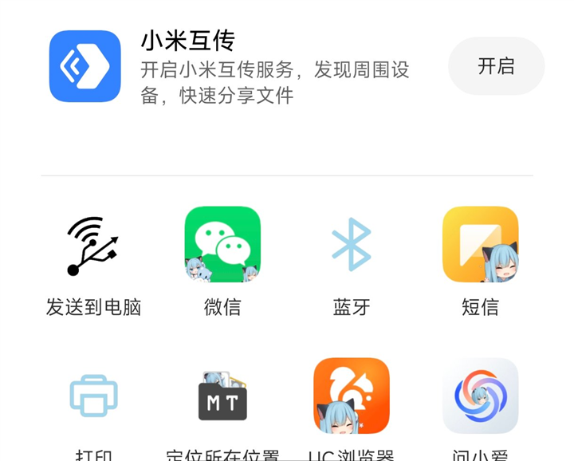
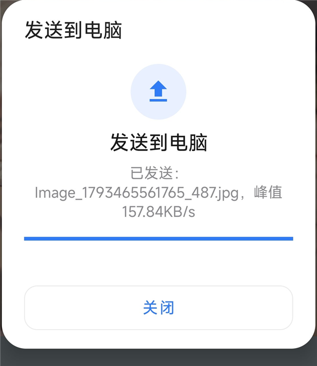
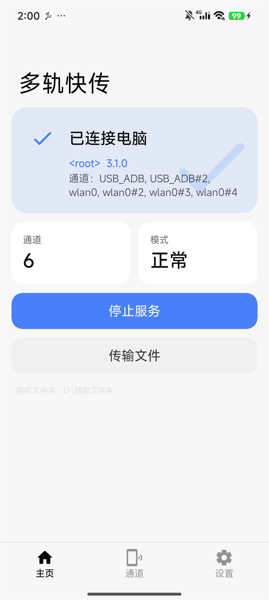
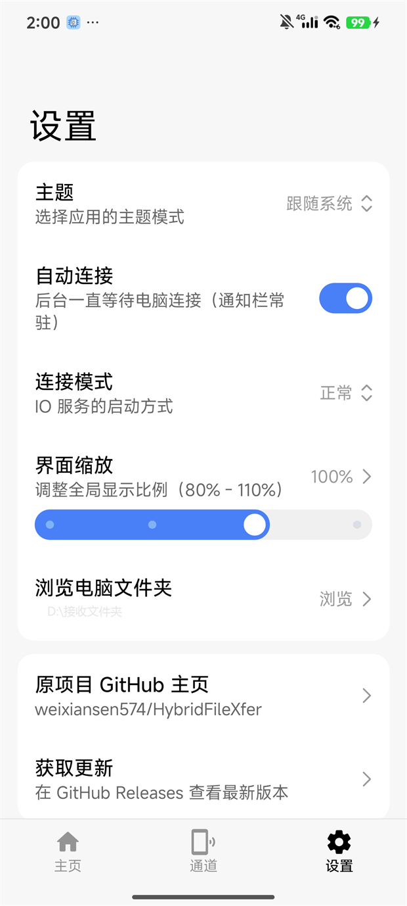
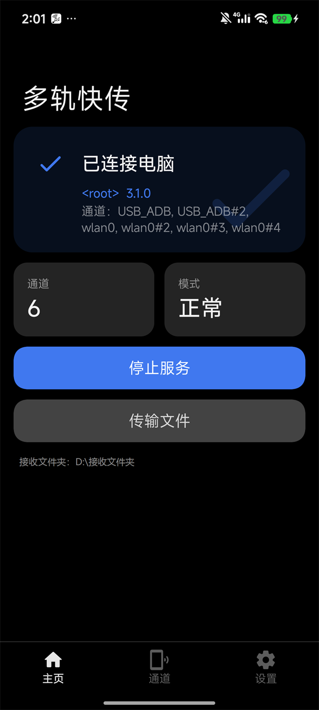
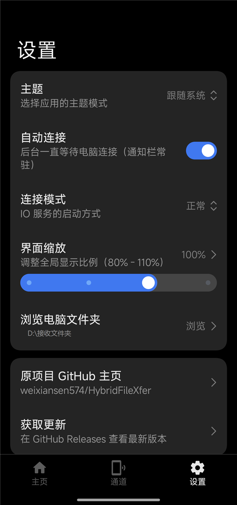
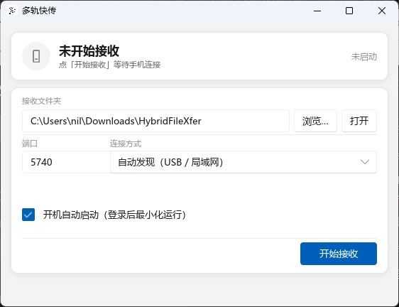

# 多轨快传

当前版本 **3.1.0** · 安卓界面基于 **Miuix 0.9** · 许可 **GPL-3.0**

📥 [下载最新版本](https://github.com/yizhiruonan/HybridFileXfer/releases) ｜ 安卓 **8.0（API 26）及以上** ｜ 电脑端 **Windows 10 及以上**（64 位 / 32 位都有，**不需要 Java**）

多轨快传（原双轨快传）：把手机的 USB、WiFi、热点等多张网卡同时用起来，把文件传到电脑。手机与电脑点对点直连，不经过任何服务器。

原作者实测：USB2.0 + WiFi6（千兆网口）150 MB/s；USB2.0 + WiFi6 5G:160MHz + 2.4G:40MHz 200+ MB/s。
本项目实测：USB2.0（adb 约 38 MB/s）+ WiFi6 5GHz（1201 Mbps 协商）聚合稳定约 **76 MB/s**，实际取决于网卡、数据线与电脑磁盘。

## 项目结构

| 目录 | 说明 |
| --- | --- |
| `HybridFileXfer-Android/` | 安卓客户端（Java + Jetpack Compose / Miuix UI） |
| `HybridFileXfer-Receiver/` | 电脑接收器（Rust + Slint，原生 Windows 风格界面；GUI 与 CLI 双入口，不需要 Java） |
| `HybridFileXfer-PC/` | 经典 Java 电脑客户端源码（旧版，可选；不含 jar 与 adb.exe） |
| `script/` | adb 端口转发、一键编译等辅助脚本 |

## 功能

- **一键发送到电脑**：在文件管理器里长按文件选「分享」→ 发送到电脑，或任何应用的系统分享按钮，都能直接传到电脑，**不用打开 App、不用在两端来回点**，一次设置长期有效。
- **多通道聚合**：WiFi 自动 4 条、USB 自动 2 条通道，每条可单独开关
- **分享面板直发**：任意文件管理器里分享到「发送到电脑」，直接写进电脑的接收文件夹
- **插线自动连接**：接收器通过 adb 端口转发拉起手机端服务，插上数据线 1~2 秒建立连接
- **三种运行模式**：正常 / ROOT / ADB（ROOT 需要 root，ADB 依靠 Shizuku）
- **主题**：跟随系统 / 浅色 / 深色 / Monet 取色，共 6 档
- **限速**：按 MB/s 限制发送速率，0 表示不限速
- **浏览电脑文件夹**：手机端可直接浏览并切换电脑的接收目录

## 界面

### 一键发送到电脑

任意文件管理器长按文件、或在任何应用里点系统的「分享」，选 **发送到电脑** 就直接传，不用打开 App：

| 分享面板 | 发送进度 |
| --- | --- |
|  |  |

### 电脑 → 手机（右键发送）

电脑上右键任意文件 → **发送到 → 发送到手机**，手机会自动接收，全程不用在手机上操作。

- **接收位置**：设置 →「电脑推送保存到」，可用系统选择器选目录，也可手动输入路径（存储根目录等系统不让选的目录用这个）
- **接收提示**：手机端浮层实时显示文件名、分块进度条与速率
- 电脑端首次运行会自动在「发送到」菜单里创建快捷方式

### 应用界面

安卓端基于 Miuix，浅色 / 深色 / Monet 三套主题。

| 主页（浅色） | 设置（浅色） |
| --- | --- |
|  |  |

| 主页（深色） | 设置（深色） |
| --- | --- |
|  |  |

电脑接收器（Rust + Slint，原生 Windows 风格）：

## 快速开始

### 手机端

1. 安装 [Releases](https://github.com/yizhiruonan/HybridFileXfer/releases) 里的 `app-release.apk`，授予文件访问权限
2. 连上 WiFi（与电脑同局域网）和/或插上数据线并在开发者选项里打开 USB 调试
3. 在「通道」页勾选要用的网卡，回「主页」点 **启动服务并等待连接**
4. 想插线即连，可在「设置」里打开 **自动连接**

### 电脑端

1. 下载运行 `HybridFileXfer-Receiver.exe`（64 位图形界面版；32 位用 `HybridFileXfer-Receiver-x86.exe`，命令行版用 `-cli.exe`）
2. 点「浏览…」选接收文件夹，点 **开始接收**
3. 手机端显示「已连接电脑」后，直接分享文件即可

> 经典 Java 客户端（`HybridFileXfer-PC/` 源码）仍可使用，但仓库不附带编译好的 jar 与 `adb.exe`。

## 从源码编译

**手机端**：进入 `HybridFileXfer-Android` 执行 `gradlew assembleDebug`

- 需要 JDK 17、Android SDK Platform 37、NDK 25.1.8937393、CMake 3.22.1
- 工具链：Gradle 9.6 / AGP 9.4.1 / Kotlin 2.4.20 / compileSdk 37 / minSdk 26 / Miuix 0.9.4

**电脑接收器**：进入 `HybridFileXfer-Receiver` 执行 `build.bat`（需要 Rust 1.85+），详见该目录下的 README。

## 说明与限制

- **权限**：`~/Android/data/` 需要 ROOT 模式，ADB 模式访问不到；USB 协议等级读取依赖 root 或 SukiSU 授权
- **网卡选择**：能被识别为网卡的都会列出（WiFi / 双 WiFi 加速 / 热点 / USB 网络共享 / 以太网）；VPN 的 TUN 网卡不要选
- **USB 通道**：走 `adb forward`，电脑端会自动完成端口转发
- **蜂窝网络**：不支持（架构是电脑主动连手机，蜂窝 NAT 进不来，需要公网中继）
- **进度条**：未实现（海量小文件时算进度的时间可能超过传输本身）

## 更新日志

### 3.1.0

- 电脑接收器界面改用 **Slint + fluent**，控件是 Windows 11 原生观感
- 安卓界面迁移到 **Miuix 0.9.4**，设置页改为分组圆角卡片
- 新增 **主题**：跟随系统 / 浅色 / 深色 / Monet（6 档，写入配置持久化）
- 界面缩放改用 `SliderPreference`，刻度点用原生 `showKeyPoints`
- 移除「更新来源仓库」设置，获取更新固定指向本仓库 Releases
- 修复：卡片与背景同色导致圆角分组消失、应用内深色时状态栏图标不可见、Android 16 预测性返回导致返回键失效
- 工具链升级：Gradle 9.6 / AGP 9.4.1 / compileSdk 37（**minSdk 仍为 26**）

## 来源与致谢

本项目衍生自 **[weixiansen574/HybridFileXfer](https://github.com/weixiansen574/HybridFileXfer)**（原作者 **weixiansen574**），在其基础上重做了安卓端界面并新增了电脑接收器。

## 许可证

**GNU General Public License v3.0**，见 [LICENSE.txt](./LICENSE.txt)。分发时必须保留原作者署名，并以 GPL-3.0 公开完整源代码。

当前维护：[yizhiruonan](https://github.com/yizhiruonan)
